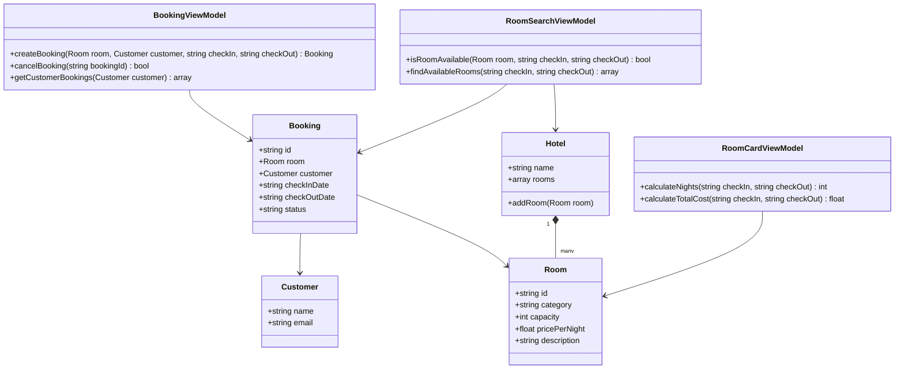
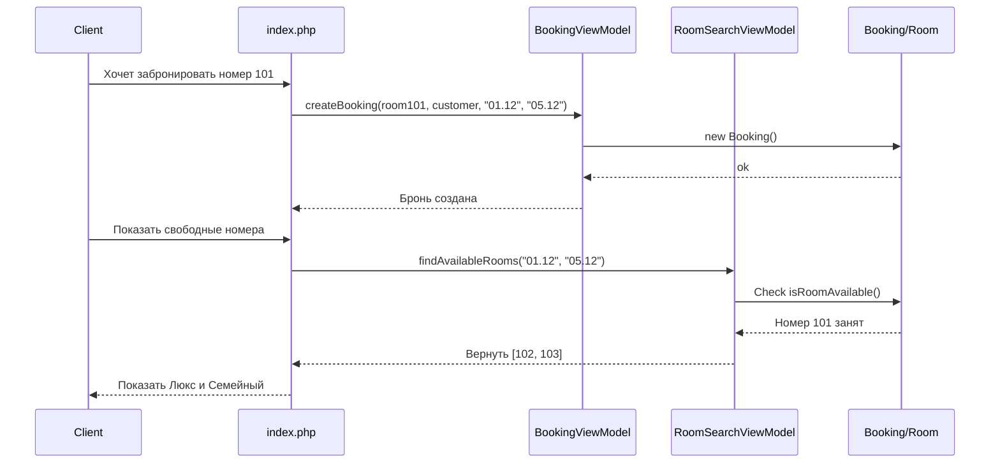

# 🏨 Лабораторная работа №5: Система бронирования гостиницы

**Вариант 2** — PHP + MVVM

## 📋 Описание проекта

Программа для бронирования номеров в гостинице, реализованная на **PHP** с использованием архитектуры **MVVM** (Model-View-ViewModel). Основная задача — отделить бизнес-логику от кода отображения страницы.

## 🏗 Архитектура MVVM

Проект разбит на три части:

| Слой | Назначение | Файлы |
|------|-----------|-------|
| **Model** | Хранение данных | `Models.php` — классы `Hotel`, `Room`, `Customer`, `Booking` |
| **ViewModel** | Бизнес-логика, расчёты, проверки | `ViewModels.php` — классы с логикой |
| **View** | Отображение | `index.php` — только вывод данных |

> View ничего не считает — он лишь отображает то, что ему передали.

## 📁 Файлы проекта

- `Models.php` — все классы с данными
- `ViewModels.php` — классы с логикой
- `index.php` — точка входа (сайт)

## ✅ Что реализовано (по заданию)

- Модели: `Hotel`, `Room`, `Customer`, `Booking`
- ViewModel для каталога, поиска, карточки номера и оформления брони
- Поиск номеров по датам
- Проверка пересечения броней (нельзя забронировать один номер дважды на одни и те же дни)
- Расчёт количества суток и итоговой стоимости
- Создание бронирования
- Отмена бронирования
- Просмотр информации о брони
- Вывод списка броней конкретного клиента

## ⚙️ Как это работает

В `index.php` реализован демонстрационный тест:

1. Создаётся отель и три номера
2. Клиент **Иван Петров** бронирует номер **101**
3. Программа ищет свободные номера на эти же даты — номер **101** не показывается (занят)
4. Считается стоимость для номера **102**
5. Показываются брони клиента
6. Бронь **101** отменяется — номер снова свободен

## 🚀 Как запустить

Требуется **PHP 8.1+**.

```bash
# Через встроенный сервер PHP
php -S localhost:8000
```

Или через **OpenServer** — разместите файлы в директории `domains/` и откройте в браузере.

## 📊 Диаграмма классов



## 🔄 Диаграмма последовательности



## 🛠 Технологии

- **PHP 8.1+**
- **MVVM** — архитектурный паттерн
- **Mermaid** — диаграммы в Markdown

---

*Лабораторная работа №5, Вариант 2*
